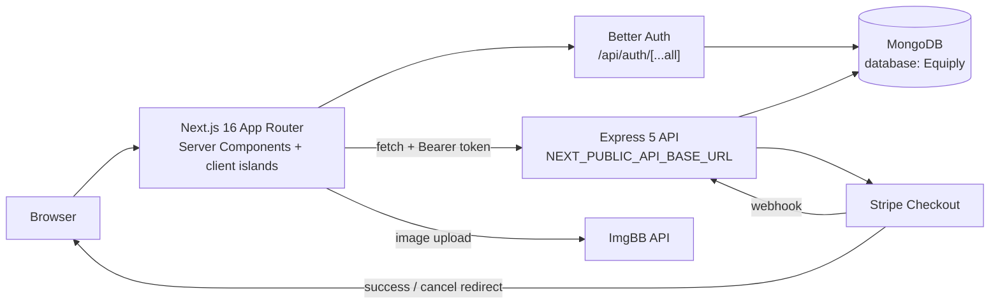
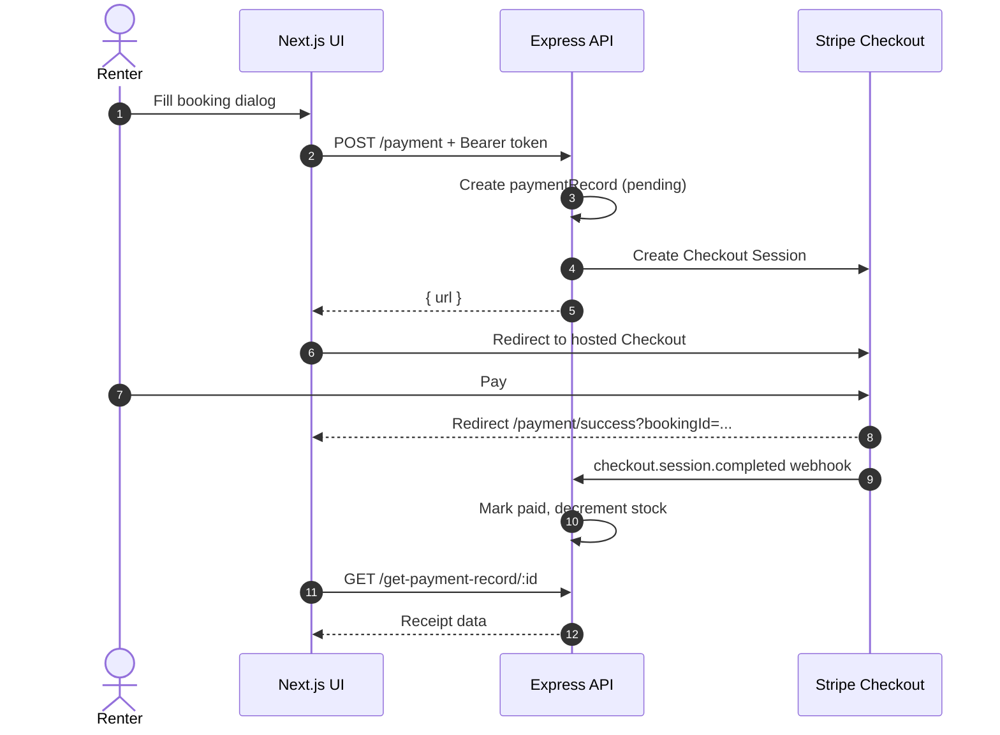

# Equiply — Equipment Rental Marketplace

<p align="center">
  
</p>

<p align="center">
  <strong>Rent the right equipment. Get more done.</strong><br />
  A Next.js 16 frontend for discovering, booking, and managing equipment rentals.
</p>

<p align="center">
  
  
  
  
  
  
  
</p>

<p align="center">
  <a href="https://github.com/mdmoshiurrahman-dev/equiply-client">Client repository</a> ·
  <a href="https://github.com/mdmoshiurrahman-dev/equiply-back-end">Backend repository</a>
</p>

> **Scope:** This repository is the **client application only**. Authentication is handled here by **Better Auth**, which writes its user, session, and account records to MongoDB. Equipment data, bookings, favorites, reviews, and Stripe Checkout sessions are owned by the separate **Express + MongoDB + Stripe** backend. The backend has its own README with the full API contract.

---

## Table of Contents

- [Overview](#overview)
- [Features](#features)
- [Tech Stack](#tech-stack)
- [Architecture](#architecture)
- [Project Structure](#project-structure)
- [Getting Started](#getting-started)
- [Environment Variables](#environment-variables)
- [Routes and Access](#routes-and-access)
- [Roles and Permissions](#roles-and-permissions)
- [Application Flows](#application-flows)
- [Payments](#payments)
- [Backend API Integration](#backend-api-integration)
- [Design System and Conventions](#design-system-and-conventions)
- [Scripts](#scripts)
- [Deployment](#deployment)
- [Troubleshooting](#troubleshooting)
- [Security Notes](#security-notes)
- [Production Checklist](#production-checklist)
- [Contributing](#contributing)
- [License](#license)
- [Acknowledgements](#acknowledgements)

---

## Overview

**Equiply** is an equipment rental marketplace. Equipment owners list their tools and machines, renters find and book them, and administrators moderate listings, applications, users, and rentals. Payments are handled through **Stripe Checkout**.

This repository contains the complete **Next.js frontend**:

- A public marketing site and equipment catalog.
- Email/password and Google authentication through **Better Auth**.
- Renter onboarding, favorites, booking, payment history, and reviews.
- Provider onboarding, equipment listing management, and rental requests.
- An admin console for users, owner applications, equipment moderation, rentals, and analytics.
- A shared dashboard shell with role-aware navigation, dark/light themes, loading skeletons, and toasts.

### What lives where

| Concern | Owner |
| --- | --- |
| Next.js pages, layouts, UI, forms, client-side validation | This repository |
| Better Auth session cookie and `/api/auth/[...all]` handler | This repository |
| Better Auth user/session/account records | MongoDB database `Equiply` |
| Equipment, payment records, favorites, reviews | Backend Express API |
| Stripe Checkout session creation and webhook | Backend Express API |
| Uploaded images | ImgBB |
| Marketing copy, filter options, reviews seed data | This repository (`*.data.ts` files and components) |

### Project at a glance

| Metric | Count |
| --- | ---: |
| Page routes (`page.tsx`) | 27 |
| Layouts (`layout.tsx`) | 8 |
| Route-level loading states (`loading.tsx`) | 11 |
| Auth API route handlers | 1 |
| Source files under `src/` | 260 |
| Component files | 200 |
| Reusable UI primitives | 21 |
| Public assets | 1 (`banner_image.jpeg`) |

---

## Features

### Storefront and discovery

- Animated landing page with hero, featured equipment, top categories, social proof, reviews, and a three-step rental process.
- Equipment catalog at `/equipment` with text search, category, rental type, price range, availability, and sorting.
- URL-driven filters (`searchParams`) so filtered catalog states are shareable and refresh-safe.
- Equipment detail page with image, specifications, owner card, rental terms, availability, favorite toggle, and booking dialog.
- Empty state, responsive grid, image fallbacks, and skeleton loading states.
- About and contact pages.
- Responsive navbar, mobile menu, footer, and light/dark theme toggle.

### Accounts and onboarding

- Email/password sign-up and sign-in through Better Auth.
- Google OAuth sign-in; new social users are routed to account-type selection.
- Zod + React Hook Form validation on the sign-up form: name length, valid email, password strength, and confirm-password match.
- Remember-me option, password visibility toggles, social divider, and toast feedback.
- Account-type selection: **Renter** or **Equipment Owner**.
- Renter application with personal information, phone, location, NID, and profile image.
- Owner application with personal details, business address, account type, equipment category, price range, description, and image upload.
- Owner applications enter a `pending` state for administrator review.

### Renter workspace

- Rental/payment history at `/dashboard/renter`.
- Favorites table with equipment previews, view links, and remove action.
- Equipment booking with date range, quantity, contact number, delivery address, and notes.
- Stripe Checkout redirect and a printable success receipt.
- Review submission with a 5-star picker.
- Shared profile editor with avatar upload.

### Provider workspace

- Multi-section add-equipment form: basic information, specifications, rental information, image, and rental terms.
- New listings are submitted as `pending` and require admin approval.
- My Listings table with status badges, update, details, and delete actions.
- Incoming rental requests with renter information and status.
- Rental payment detail view covering equipment, renter, delivery, and payment summary.
- Shared profile editor.

### Admin workspace

- User management with role changes (`admin`, `renter`, `provider`) and deletion; self-deletion is blocked in the UI.
- Owner application review with accept/reject actions and summary statistics.
- Equipment moderation: approve, reject, update, view details, and delete any listing.
- Rental management with all payment records and summary cards.
- Analytics dashboard: equipment-by-category pie chart, seven-day registration trends for renters vs providers, and payment success/failure performance.
- Shared profile editor.

### Platform and UX

- Next.js App Router with React Server Components by default and client islands only where interaction is needed.
- Server-side session loading and per-role dashboard guards.
- Suspense boundaries and route-level `loading.tsx` files.
- Base UI + shadcn-style component primitives, Lucide icons, and reusable toast notifications.
- Tailwind CSS v4 design tokens, OKLCH colors, dark mode, and responsive layouts.
- Framer Motion animations with `useReducedMotion` support and CSS keyframes.
- Accessible labels, landmarks, `aria-*` attributes, focus-visible states, and semantic tables/forms.

---

## Tech Stack

| Layer | Technology | Version / Notes |
| --- | --- | --- |
| Framework | [Next.js](https://nextjs.org/) | `16.4.6`, App Router, Turbopack, React Compiler |
| UI runtime | [React](https://react.dev/) | `19.3.0` |
| Language | [TypeScript](https://www.typescriptlang.org/) | `^5`, strict mode |
| Styling | [Tailwind CSS](https://tailwindcss.com/) | `4.3.3`, CSS-first configuration |
| Component system | [shadcn/ui](https://ui.shadcn.com/) + [Base UI](https://base-ui.com/) | `base-nova`, `@base-ui/react` `1.9` |
| Auth | [Better Auth](https://www.better-auth.com/) | `1.7.25`, MongoDB adapter |
| Database driver | [MongoDB](https://www.mongodb.com/) | `7.9.0` |
| Payments | [Stripe](https://stripe.com/) | `stripe` `23.2`, hosted Checkout (server-driven) |
| Image uploads | [ImgBB](https://api.imgbb.com/) | REST upload from the browser |
| Charts | [Recharts](https://recharts.org/) | `3.11.1` |
| Motion | [Framer Motion](https://motion.dev/) | `14.14.0` + CSS animations |
| Forms | [React Hook Form](https://react-hook-form.com/) + [Zod](https://zod.dev/) | `7.92` / `4.6` |
| Icons | [Lucide](https://lucide.dev/) | `1.75` |
| Theming | [next-themes](https://github.com/pacocoursey/next-themes) | `0.4.6` |
| Linting | [ESLint](https://eslint.org/) | `9` + `eslint-config-next` |

### Configuration notes

- `next.config.ts` enables `cacheComponents`, `partialPrefetching`, and `reactCompiler`.
- Remote images are allowed from **any HTTPS host** via `images.remotePatterns`; tighten this allowlist before production.
- A Turbopack rule loads `*.css` through `@tailwindcss/turbopack`.
- `tsconfig.json` uses strict mode, bundler module resolution, and the `@/*` → `./src/*` path alias.
- `components.json` configures shadcn with the `base-nova` style, RSC enabled, neutral base color, CSS variables, Lucide icons, and `@/components` aliases.
- `src/app/globals.css` imports Tailwind, `tw-animate-css`, and the shadcn Tailwind layer, then defines the design tokens and keyframes.

---

## Architecture



### Rendering model

- **Server Components** are the default. Pages fetch data, read the session, and pass serializable props into client components.
- **Client Components** (`"use client"`) handle forms, dialogs, filters, charts, the sidebar, the theme toggle, and session hooks.
- Protected server pages call `loadUserSessionFromServerComponent()`, which reads the Better Auth session from request headers and redirects unauthenticated users to `/sign-in`.
- Role dashboards are wrapped by `RoleGuard`, which redirects users without the exact role to `/unauthorized`.
- Client-side mutations use `useSession()` to obtain the session token, then call the backend with `Authorization: Bearer <token>`.
- Public catalog requests do not send an auth header.

### Data ownership

- **Better Auth** uses the MongoDB adapter and the hard-coded database name `Equiply` in `src/lib/auth.ts`.
- The backend API is the source of truth for equipment, payment records, favorites, and reviews.
- The frontend does not query business collections directly; it only talks to the API.
- The frontend does not handle card data. Stripe Checkout is hosted by Stripe.

---

## Project Structure

```text
client/
├── public/
│   └── banner_image.jpeg              # Hero / README banner
├── src/
│   ├── app/                           # App Router: pages, layouts, loading states
│   │   ├── (public)/                  # Marketing, catalog, auth, onboarding
│   │   │   ├── (auth)/
│   │   │   │   ├── sign-in/page.tsx
│   │   │   │   └── sign-up/page.tsx
│   │   │   ├── about/page.tsx
│   │   │   ├── account-type/
│   │   │   │   ├── customer-application/page.tsx
│   │   │   │   ├── equipment-owner-application/page.tsx
│   │   │   │   └── page.tsx
│   │   │   ├── api/auth/[...all]/route.ts
│   │   │   ├── contract-us/page.tsx
│   │   │   ├── equipment/
│   │   │   │   ├── details/[id]/
│   │   │   │   │   ├── loading.tsx
│   │   │   │   │   └── page.tsx
│   │   │   │   └── page.tsx
│   │   │   ├── layout.tsx
│   │   │   └── page.tsx
│   │   ├── dashboard/
│   │   │   ├── admin/
│   │   │   │   ├── analyze/page.tsx
│   │   │   │   ├── equipment/
│   │   │   │   │   ├── loading.tsx
│   │   │   │   │   └── page.tsx
│   │   │   │   ├── owner-applications/page.tsx
│   │   │   │   ├── rentals/
│   │   │   │   │   ├── loading.tsx
│   │   │   │   │   └── page.tsx
│   │   │   │   ├── layout.tsx
│   │   │   │   ├── loading.tsx
│   │   │   │   └── page.tsx
│   │   │   ├── equipment-info/[id]/
│   │   │   │   ├── loading.tsx
│   │   │   │   └── page.tsx
│   │   │   ├── profile/
│   │   │   │   ├── loading.tsx
│   │   │   │   └── page.tsx
│   │   │   ├── provider/
│   │   │   │   ├── equipment/page.tsx
│   │   │   │   ├── rentals/
│   │   │   │   │   ├── payment-info/[id]/
│   │   │   │   │   │   ├── loading.tsx
│   │   │   │   │   │   └── page.tsx
│   │   │   │   │   └── page.tsx
│   │   │   │   ├── layout.tsx
│   │   │   │   └── page.tsx
│   │   │   ├── renter/
│   │   │   │   ├── favorites/page.tsx
│   │   │   │   ├── layout.tsx
│   │   │   │   ├── loading.tsx
│   │   │   │   └── page.tsx
│   │   │   ├── update/[id]/
│   │   │   │   ├── loading.tsx
│   │   │   │   └── page.tsx
│   │   │   └── layout.tsx
│   │   ├── payment/
│   │   │   ├── cancel/
│   │   │   │   ├── loading.tsx
│   │   │   │   └── page.tsx
│   │   │   ├── success/
│   │   │   │   ├── download-pdf-button.tsx
│   │   │   │   ├── loading.tsx
│   │   │   │   └── page.tsx
│   │   │   └── layout.tsx
│   │   ├── unauthorized/
│   │   │   ├── layout.tsx
│   │   │   └── page.tsx
│   │   ├── favicon.ico
│   │   ├── globals.css
│   │   └── layout.tsx
│   ├── components/
│   │   ├── about/                     # About page sections
│   │   ├── account-type/              # Account type cards + application forms
│   │   │   ├── customer-application/
│   │   │   └── equipment-owner-application/
│   │   ├── auth/                      # Sign-in, sign-up, social buttons, logout
│   │   ├── booking/booking-diaglog/   # Rental booking dialog
│   │   ├── contract-us/               # Contact page sections
│   │   ├── dashboard/
│   │   │   ├── admin/                 # Users, applications, equipment, rentals, analytics
│   │   │   ├── profile/
│   │   │   ├── provider/              # Add equipment, listings, rental requests
│   │   │   ├── renter/                # Rental history, favorites
│   │   │   ├── route-geard/           # Unauthorized screen + skeleton
│   │   │   ├── sidebar/               # Dashboard sidebar, links, user menu
│   │   │   ├── update/                # Shared equipment edit form
│   │   │   ├── role-guard.tsx
│   │   │   └── role-guard-skeleton.tsx
│   │   ├── equipment/                 # Catalog grid, filters, cards, pagination
│   │   ├── equipment-info/            # Details sections, owner card, favorites
│   │   ├── home/                      # Hero, categories, featured, nav, footer, reviews
│   │   └── ui/                        # 21 reusable Base UI / shadcn primitives
│   ├── hooks/
│   │   └── use-mobile.ts
│   ├── lib/
│   │   ├── action/
│   │   │   ├── authFetch.ts
│   │   │   └── uploadImage.ts
│   │   ├── core/
│   │   │   ├── loadUserSessionFromServerComponent.ts
│   │   │   └── requreRole.ts
│   │   ├── auth.ts
│   │   ├── auth-client.ts
│   │   ├── stripe.js
│   │   └── utils.ts
│   └── types/
│       └── type.ts
├── .dev.log                           # Tracked dev-server log (artifact)
├── .gitignore
├── .next-dev.log                      # Tracked dev-server log (artifact)
├── .root.css                          # Captured dev CSS output (artifact)
├── .served.css                        # Captured dev CSS output (artifact)
├── components.json
├── eslint.config.mjs
├── next-env.d.ts
├── next.config.ts
├── package-lock.json
├── package.json
├── README.md
└── tsconfig.json
```

> `.env`, `.env.local`, `.next/`, `node_modules/`, and `*.tsbuildinfo` are omitted. `.dev.log`, `.next-dev.log`, `.root.css`, and `.served.css` are tracked development artifacts, not application source; remove and ignore them in a cleanup PR.

### Folder reference

| Path | Responsibility |
| --- | --- |
| `src/app/` | Route segments, layouts, loading states, metadata, and server-side data loading. |
| `src/app/(public)/` | Public route group sharing the marketing navbar and footer. Parentheses keep the segment out of the URL. |
| `src/app/(public)/(auth)/` | Auth pages nested inside the public layout. |
| `src/app/dashboard/` | Dashboard shell with sidebar, header, theme toggle, and toaster. |
| `src/app/dashboard/{admin,renter,provider}/` | Role-scoped dashboards guarded by `RoleGuard`. |
| `src/app/payment/` | Stripe return pages with a minimal layout. |
| `src/app/unauthorized/` | Standalone 403 screen. |
| `src/components/` | Feature-oriented UI components grouped by domain. |
| `src/components/ui/` | Reusable, low-level UI primitives (button, dialog, table, sidebar, toast, etc.). |
| `src/hooks/` | Shared client hooks. |
| `src/lib/` | Auth configuration, session helpers, role helpers, API actions, uploads, and utilities. |
| `src/types/` | Central domain types shared across pages and components. |
| `public/` | Static assets served from `/`. |

### Key files

| File | Purpose |
| --- | --- |
| `src/lib/auth.ts` | Better Auth server configuration: MongoDB adapter, Google provider, email/password, and the additional `role` field. |
| `src/lib/auth-client.ts` | Browser auth client with inferred additional fields; exports `signIn`, `signUp`, `signOut`, `useSession`. |
| `src/lib/core/loadUserSessionFromServerComponent.ts` | Reads the session in Server Components and redirects to `/sign-in` when absent. |
| `src/lib/core/requreRole.ts` | Small server-side role helper (`isAuthorized`) retained alongside the `RoleGuard` implementation. |
| `src/components/dashboard/role-guard.tsx` | Suspense-wrapped exact-role guard that redirects mismatches to `/unauthorized`. |
| `src/app/(public)/api/auth/[...all]/route.ts` | Better Auth Next.js handler for all auth endpoints. |
| `src/lib/action/uploadImage.ts` | Uploads a `File` to ImgBB and returns the hosted URL (or an empty string on failure). |
| `src/lib/action/authFetch.ts` | Small authenticated JSON fetch helper. |
| `src/lib/stripe.js` | Server-only Stripe client. Currently not imported by the app because Checkout is created by the backend. |
| `src/types/type.ts` | User, equipment, rental, review, sidebar, and dashboard types. |
| `src/app/globals.css` | Tailwind imports, design tokens, dark theme, chart colors, and keyframes. |
| `next.config.ts` | Cache Components, partial prefetching, React Compiler, remote images, and Turbopack CSS. |
| `components.json` | shadcn/ui configuration (`base-nova`, RSC, aliases, CSS variables). |

### Route groups and naming conventions

- `(public)` and `(auth)` are **route groups**; they do not appear in the URL.
- `[id]` is a dynamic route parameter; `[...all]` is a catch-all used by Better Auth.
- The dashboard root has **no index page**. Role entry points are `/dashboard/admin`, `/dashboard/renter`, and `/dashboard/provider`.
- Existing spellings should be preserved when editing: `contract-us`, `add-equepment`, `route-geard`, `requreRole`, and `bookingDiaglog`.

<details>
<summary><strong>Expand complete source inventory (261 files)</strong></summary>

```text
  public/banner_image.jpeg
  src/app/dashboard/admin/analyze/page.tsx
  src/app/dashboard/admin/equipment/loading.tsx
  src/app/dashboard/admin/equipment/page.tsx
  src/app/dashboard/admin/layout.tsx
  src/app/dashboard/admin/loading.tsx
  src/app/dashboard/admin/owner-applications/page.tsx
  src/app/dashboard/admin/page.tsx
  src/app/dashboard/admin/rentals/loading.tsx
  src/app/dashboard/admin/rentals/page.tsx
  src/app/dashboard/equipment-info/[id]/loading.tsx
  src/app/dashboard/equipment-info/[id]/page.tsx
  src/app/dashboard/layout.tsx
  src/app/dashboard/profile/loading.tsx
  src/app/dashboard/profile/page.tsx
  src/app/dashboard/provider/equipment/page.tsx
  src/app/dashboard/provider/layout.tsx
  src/app/dashboard/provider/page.tsx
  src/app/dashboard/provider/rentals/page.tsx
  src/app/dashboard/provider/rentals/payment-info/[id]/loading.tsx
  src/app/dashboard/provider/rentals/payment-info/[id]/page.tsx
  src/app/dashboard/renter/favorites/page.tsx
  src/app/dashboard/renter/layout.tsx
  src/app/dashboard/renter/loading.tsx
  src/app/dashboard/renter/page.tsx
  src/app/dashboard/update/[id]/loading.tsx
  src/app/dashboard/update/[id]/page.tsx
  src/app/favicon.ico
  src/app/globals.css
  src/app/layout.tsx
  src/app/payment/cancel/loading.tsx
  src/app/payment/cancel/page.tsx
  src/app/payment/layout.tsx
  src/app/payment/success/download-pdf-button.tsx
  src/app/payment/success/loading.tsx
  src/app/payment/success/page.tsx
  src/app/(public)/about/page.tsx
  src/app/(public)/account-type/customer-application/page.tsx
  src/app/(public)/account-type/equipment-owner-application/page.tsx
  src/app/(public)/account-type/page.tsx
  src/app/(public)/api/auth/[...all]/route.ts
  src/app/(public)/(auth)/sign-in/page.tsx
  src/app/(public)/(auth)/sign-up/page.tsx
  src/app/(public)/contract-us/page.tsx
  src/app/(public)/equipment/details/[id]/loading.tsx
  src/app/(public)/equipment/details/[id]/page.tsx
  src/app/(public)/equipment/page.tsx
  src/app/(public)/layout.tsx
  src/app/(public)/page.tsx
  src/app/unauthorized/layout.tsx
  src/app/unauthorized/page.tsx
  src/components/about/about-intro.tsx
  src/components/about/the-challenge.tsx
  src/components/about/who-we-are.tsx
  src/components/account-type/account-type-card.tsx
  src/components/account-type/customer-application/customer-application-form.tsx
  src/components/account-type/customer-application/field-hint.tsx
  src/components/account-type/customer-application/form-field.tsx
  src/components/account-type/customer-application/form-section.tsx
  src/components/account-type/equipment-owner-application/equipment-owner-form.tsx
  src/components/account-type/equipment-owner-application/form-field.tsx
  src/components/account-type/equipment-owner-application/form-section.tsx
  src/components/account-type/equipment-owner-application/phone-field.tsx
  src/components/auth/auth-divider.tsx
  src/components/auth/logout/LogOut.tsx
  src/components/auth/password-input.tsx
  src/components/auth/sign-in/sign-in-card.tsx
  src/components/auth/sign-in/sign-in-form.tsx
  src/components/auth/sign-up/sign-up-card.tsx
  src/components/auth/sign-up/sign-up-form.tsx
  src/components/auth/social/social-buttons.tsx
  src/components/booking/booking-diaglog/bookingDiaglog.tsx
  src/components/contract-us/contact-info.tsx
  src/components/contract-us/contract-hero.tsx
  src/components/contract-us/index.ts
  src/components/dashboard/admin/analyze/category-analyze/category-legend.tsx
  src/components/dashboard/admin/analyze/category-analyze/equipment-category-chart.tsx
  src/components/dashboard/admin/analyze/category-analyze/equipment-category-data.ts
  src/components/dashboard/admin/analyze/payment-perfomance/payment-performance-chart.tsx
  src/components/dashboard/admin/analyze/payment-perfomance/payment-performance-data.ts
  src/components/dashboard/admin/analyze/payment-perfomance/payment-performance-stats.tsx
  src/components/dashboard/admin/analyze/payment-perfomance/payment-performance.tsx
  src/components/dashboard/admin/analyze/registration/analyze.tsx
  src/components/dashboard/admin/analyze/registration/chart-skeleton.tsx
  src/components/dashboard/admin/analyze/registration/registration-trends-chart.tsx
  src/components/dashboard/admin/analyze/registration/registration-trends-data.ts
  src/components/dashboard/admin/analyze/registration/registration-trends.tsx
  src/components/dashboard/admin/equipment/action-buttons.tsx
  src/components/dashboard/admin/equipment/data.ts
  src/components/dashboard/admin/equipment/equipment-management-skeleton.tsx
  src/components/dashboard/admin/equipment/equipment-management.tsx
  src/components/dashboard/admin/equipment/equipment-table.tsx
  src/components/dashboard/admin/equipment/filter-toolbar.tsx
  src/components/dashboard/admin/equipment/page-header.tsx
  src/components/dashboard/admin/equipment/stats-cards.tsx
  src/components/dashboard/admin/equipment/status-badge.tsx
  src/components/dashboard/admin/equipment/table-footer.tsx
  src/components/dashboard/admin/equipment/thin-scrollbar.ts
  src/components/dashboard/admin/owner-application/application-action.tsx
  src/components/dashboard/admin/owner-application/applications.tsx
  src/components/dashboard/admin/owner-application/application-table.tsx
  src/components/dashboard/admin/owner-application/filter-toolbar.tsx
  src/components/dashboard/admin/owner-application/moc/constants.ts
  src/components/dashboard/admin/owner-application/NoApplicationFallback.tsx
  src/components/dashboard/admin/owner-application/owner-applications.tsx
  src/components/dashboard/admin/owner-application/page-header.tsx
  src/components/dashboard/admin/owner-application/stats-cards.tsx
  src/components/dashboard/admin/owner-application/table-footer.tsx
  src/components/dashboard/admin/owner-application/TableSkeleton.tsx
  src/components/dashboard/admin/rentals/index.ts
  src/components/dashboard/admin/rentals/rentals-header.tsx
  src/components/dashboard/admin/rentals/rentals-page.tsx
  src/components/dashboard/admin/rentals/rentals-table.tsx
  src/components/dashboard/admin/rentals/stats-cards.tsx
  src/components/dashboard/admin/user-management/data/users.ts
  src/components/dashboard/admin/user-management/role-badge.tsx
  src/components/dashboard/admin/user-management/user-filters.tsx
  src/components/dashboard/admin/user-management/user-management-skeleton.tsx
  src/components/dashboard/admin/user-management/user-management.tsx
  src/components/dashboard/admin/user-management/user-row-actions.tsx
  src/components/dashboard/admin/user-management/user-row.tsx
  src/components/dashboard/admin/user-management/users-table-pagination.tsx
  src/components/dashboard/admin/user-management/users-table.tsx
  src/components/dashboard/profile/ProfileChild.tsx
  src/components/dashboard/provider/add-equepment/add-equipment-form.tsx
  src/components/dashboard/provider/add-equepment/basic-information-section.tsx
  src/components/dashboard/provider/add-equepment/equipment-image-section.tsx
  src/components/dashboard/provider/add-equepment/form-field.tsx
  src/components/dashboard/provider/add-equepment/form-section.tsx
  src/components/dashboard/provider/add-equepment/rental-information-section.tsx
  src/components/dashboard/provider/add-equepment/rental-terms-section.tsx
  src/components/dashboard/provider/add-equepment/specifications-section.tsx
  src/components/dashboard/provider/equipment/equipment-actions.tsx
  src/components/dashboard/provider/equipment/equipment-listings.tsx
  src/components/dashboard/provider/equipment/equipment-table.tsx
  src/components/dashboard/provider/equipment/index.ts
  src/components/dashboard/provider/equipment/moc/mock-data.ts
  src/components/dashboard/provider/equipment/page-header.tsx
  src/components/dashboard/provider/equipment/status-badge.tsx
  src/components/dashboard/provider/equipment/TableBody.tsx
  src/components/dashboard/provider/rentals/index.ts
  src/components/dashboard/provider/rentals/payment-info/equipment-information.tsx
  src/components/dashboard/provider/rentals/payment-info/payment-summary.tsx
  src/components/dashboard/provider/rentals/payment-info/rental-delivery.tsx
  src/components/dashboard/provider/rentals/payment-info/rental-payment-details-skeleton.tsx
  src/components/dashboard/provider/rentals/payment-info/rental-payment-details.tsx
  src/components/dashboard/provider/rentals/payment-info/renter-information.tsx
  src/components/dashboard/provider/rentals/payment-info/types.ts
  src/components/dashboard/provider/rentals/payment-info/ui/info-card.tsx
  src/components/dashboard/provider/rentals/payment-info/ui/info-field.tsx
  src/components/dashboard/provider/rentals/rental-requests-data.ts
  src/components/dashboard/provider/rentals/rental-requests.tsx
  src/components/dashboard/provider/rentals/rental-status-badge.tsx
  src/components/dashboard/provider/rentals/rental-table-skeleton.tsx
  src/components/dashboard/provider/rentals/rental-table.tsx
  src/components/dashboard/provider/rentals/renter-info.tsx
  src/components/dashboard/provider/rentals/TableBody.tsx
  src/components/dashboard/renter/favorites/favorites-data.ts
  src/components/dashboard/renter/favorites/favorites-header.tsx
  src/components/dashboard/renter/favorites/favorites-table-card.tsx
  src/components/dashboard/renter/favorites/favorites-table-row.tsx
  src/components/dashboard/renter/favorites/favorites-table.tsx
  src/components/dashboard/renter/rentals/data.ts
  src/components/dashboard/renter/rentals/format.ts
  src/components/dashboard/renter/rentals/rental-history-card.tsx
  src/components/dashboard/renter/rentals/rentals-header.tsx
  src/components/dashboard/renter/rentals/rentals-stats.tsx
  src/components/dashboard/renter/rentals/rental-table.tsx
  src/components/dashboard/renter/rentals/stat-card.tsx
  src/components/dashboard/role-guard-skeleton.tsx
  src/components/dashboard/role-guard.tsx
  src/components/dashboard/route-geard/route-guard-skeleton.tsx
  src/components/dashboard/route-geard/Unauthorized.tsx
  src/components/dashboard/sidebar/appSidebar.tsx
  src/components/dashboard/sidebar/sidebar-brand.tsx
  src/components/dashboard/sidebar/sidebar-links.ts
  src/components/dashboard/sidebar/sidebar-nav.tsx
  src/components/dashboard/sidebar/sidebar-user.tsx
  src/components/dashboard/update/equipmentCategories.ts
  src/components/dashboard/update/update-equipment-application.tsx
  src/components/dashboard/update/update-equipment-basic-information-section.tsx
  src/components/dashboard/update/update-equipment-image-section.tsx
  src/components/dashboard/update/update-equipment-rental-information-section.tsx
  src/components/dashboard/update/update-equipment-rental-terms-section.tsx
  src/components/dashboard/update/update-equipment-skeleton.tsx
  src/components/dashboard/update/update-equipment-specifications-section.tsx
  src/components/dashboard/update/update-form-field.tsx
  src/components/dashboard/update/update-form-section.tsx
  src/components/equipment/data.ts
  src/components/equipment/equipment-card.tsx
  src/components/equipment/equipment-filters-skeleton.tsx
  src/components/equipment/equipment-filters.tsx
  src/components/equipment/equipment-grid-skeleton.tsx
  src/components/equipment/equipment-grid.tsx
  src/components/equipment/equipment-not-found.tsx
  src/components/equipment/equipment-pagination.tsx
  src/components/equipment-info/AddToFavorites.tsx
  src/components/equipment-info/data.ts
  src/components/equipment-info/EquipmentAbout.tsx
  src/components/equipment-info/equipment-details-skeleton.tsx
  src/components/equipment-info/EquipmentInfoMain.tsx
  src/components/equipment-info/EquipmentOwnerCard.tsx
  src/components/equipment-info/EquipmentRentalTerms.tsx
  src/components/equipment-info/EquipmentSpecifications.tsx
  src/components/equipment-info/EquipmentSummary.tsx
  src/components/home/categories/categories.data.ts
  src/components/home/categories/categories-section.tsx
  src/components/home/categories/category-card.tsx
  src/components/home/categories/CategorySectionMain.tsx
  src/components/home/categories/category-section-skeleton.tsx
  src/components/home/categories/fade-up.tsx
  src/components/home/feature/featured-equipment-skeleton.tsx
  src/components/home/feature/featured-equipment.tsx
  src/components/home/footer/footer.tsx
  src/components/home/header/fade-up.tsx
  src/components/home/header/hero.tsx
  src/components/home/nav/logo.tsx
  src/components/home/nav/nav-data.ts
  src/components/home/nav/nav-link.tsx
  src/components/home/nav/nav.tsx
  src/components/home/nav/theme-toggle.tsx
  src/components/home/process-section.tsx
  src/components/home/review/ReviewCarouselChild.tsx
  src/components/home/review/review-carousel-skeleton.tsx
  src/components/home/review/review-carousel.tsx
  src/components/home/review/review.data.ts
  src/components/home/review/review-form.tsx
  src/components/home/review/review-section.tsx
  src/components/home/review/star-rating.tsx
  src/components/home/why-choose-us.tsx
  src/components/ui/avatar.tsx
  src/components/ui/badge.tsx
  src/components/ui/button.tsx
  src/components/ui/card.tsx
  src/components/ui/checkbox.tsx
  src/components/ui/dialog.tsx
  src/components/ui/dropdown-menu.tsx
  src/components/ui/field.tsx
  src/components/ui/input.tsx
  src/components/ui/label.tsx
  src/components/ui/radio-group.tsx
  src/components/ui/select.tsx
  src/components/ui/separator.tsx
  src/components/ui/sheet.tsx
  src/components/ui/sidebar.tsx
  src/components/ui/skeleton.tsx
  src/components/ui/spinner.tsx
  src/components/ui/table.tsx
  src/components/ui/textarea.tsx
  src/components/ui/toast.tsx
  src/components/ui/tooltip.tsx
  src/hooks/use-mobile.ts
  src/lib/action/authFetch.ts
  src/lib/action/uploadImage.ts
  src/lib/auth-client.ts
  src/lib/auth.ts
  src/lib/core/loadUserSessionFromServerComponent.ts
  src/lib/core/requreRole.ts
  src/lib/stripe.js
  src/lib/utils.ts
  src/types/type.ts
```

</details>

---

## Getting Started

### Prerequisites

- **Node.js 20.9+** (required by Next.js 16; Node 22 LTS recommended).
- **npm 10+** (the repository uses lockfile version 3).
- A **MongoDB** connection string for Better Auth (Atlas or local).
- The **backend API** running locally or a deployed backend URL.
- **Google OAuth** credentials if you want social sign-in.
- An **ImgBB API key** if you want image uploads to work.
- A **Stripe** account configured in the backend for checkout.

### 1. Clone the client

```bash
git clone https://github.com/mdmoshiurrahman-dev/equiply-client.git
cd equiply-client
```

### 2. Install dependencies

```bash
npm install
```

### 3. Create the environment file

Create `.env.local` (recommended) or `.env` in the project root. Both are ignored by Git. Use the example in [Environment Variables](#environment-variables).

### 4. Start the backend

The client expects the Express API at `NEXT_PUBLIC_API_BASE_URL`. For local development the backend typically runs on `http://localhost:5000`:

```bash
# in the backend repository
node index.js
```

See the [backend README](https://github.com/mdmoshiurrahman-dev/equiply-back-end) for its environment, MongoDB, and Stripe setup. Alternatively, point `NEXT_PUBLIC_API_BASE_URL` at a deployed backend.

### 5. Start the development server

```bash
npm run dev
```

Open [http://localhost:3000](http://localhost:3000).

### 6. Production build

```bash
npm run build
npm run start
```

### 7. Lint

```bash
npm run lint
```

> There is currently **no automated test suite** or `npm test` script. Add one before treating the project as production-ready.

---

## Environment Variables

| Variable | Required | Scope | Used by | Description |
| --- | --- | --- | --- | --- |
| `MONGO_DB_CONNECT` | Yes | Server | `src/lib/auth.ts` | MongoDB connection string. Better Auth selects the `Equiply` database. |
| `BETTER_AUTH_SECRET` | Yes | Server | Better Auth | Secret used to sign/encrypt auth data. Generate with `openssl rand -base64 32`. |
| `BETTER_AUTH_URL` | Yes | Public | `src/lib/auth-client.ts`, Better Auth | Canonical origin of the app, e.g. `http://localhost:3000`. OAuth and cookies depend on it. |
| `NEXT_PUBLIC_API_BASE_URL` | Yes | Public | All backend fetches | Base URL of the Express API, e.g. `http://localhost:5000`. |
| `GOOGLE_CLIENT_ID` | For Google sign-in | Server | `src/lib/auth.ts` | Google OAuth client ID. |
| `GOOGLE_CLIENT_SECRET` | For Google sign-in | Server | `src/lib/auth.ts` | Google OAuth client secret. |
| `NEXT_PUBLIC_IMGBB_API_KEY` | For uploads | Public | `src/lib/action/uploadImage.ts` | ImgBB API key. Because it is `NEXT_PUBLIC_*`, it is visible in the browser bundle. |
| `NEXT_PUBLIC_STRIPE_PUBLISHABLE_KEY` | No | Public | — | Not currently used by the client; Checkout is created by the backend. |
| `STRIPE_SECRET_KEY` | No | Server | `src/lib/stripe.js` | Not currently imported by the app. Keep it server-only if you enable direct Stripe calls. |

### Example `.env.local`

```env
# Better Auth / MongoDB
MONGO_DB_CONNECT="mongodb+srv://<user>:<password>@<cluster>/<default-db>?retryWrites=true&w=majority"
BETTER_AUTH_SECRET="<generate-with-openssl-rand-base64-32>"
BETTER_AUTH_URL="http://localhost:3000"

# Backend API
NEXT_PUBLIC_API_BASE_URL="http://localhost:5000"

# Google OAuth
GOOGLE_CLIENT_ID="<google-client-id>"
GOOGLE_CLIENT_SECRET="<google-client-secret>"

# ImgBB uploads
NEXT_PUBLIC_IMGBB_API_KEY="<imgbb-api-key>"

# Optional; not used by the client today
NEXT_PUBLIC_STRIPE_PUBLISHABLE_KEY="<stripe-publishable-key>"
STRIPE_SECRET_KEY="<stripe-secret-key>"
```

### Environment notes

- `NEXT_PUBLIC_*` values are inlined at build time. Restart the dev server or redeploy after changing them.
- `MONGO_DB_CONNECT`, `GOOGLE_CLIENT_SECRET`, `BETTER_AUTH_SECRET`, and `STRIPE_SECRET_KEY` must never be exposed to the browser.
- The database name is hard-coded as `Equiply` in `src/lib/auth.ts`. The backend must use the same database for session-token validation to work.
- `BETTER_AUTH_URL` must match the origin the browser uses, including the port. In production it must be the HTTPS public URL.
- The checked-in `.gitignore` already excludes `.env*`, `.next/`, `node_modules/`, and `*.tsbuildinfo`.

---

## Routes and Access

Access values describe the **UI guard**. The backend independently authorizes every protected API request.

### Public storefront

| Route | Layout | Access | Purpose |
| --- | --- | --- | --- |
| `/` | `(public)` | Public | Landing page: hero, featured equipment, top categories, reviews, process. |
| `/about` | `(public)` | Public | About Equiply, who we are, and the challenge. |
| `/contract-us` | `(public)` | Public | Contact page. The route spelling is `contract-us`, not `contact-us`. |
| `/equipment` | `(public)` | Public | Catalog with search, filters, availability, and sorting. |
| `/equipment/details/[id]` | `(public)` | Public | Equipment details, owner card, terms, favorite toggle, and booking dialog. |
| `/sign-in` | `(public)/(auth)` | Guest | Email/password and Google sign-in. |
| `/sign-up` | `(public)/(auth)` | Guest | Account creation with client-side validation. |

### Onboarding

| Route | Layout | Access | Purpose |
| --- | --- | --- | --- |
| `/account-type` | `(public)` | Auth | Choose Renter or Equipment Owner. |
| `/account-type/customer-application` | `(public)` | Auth | Renter profile application. |
| `/account-type/equipment-owner-application` | `(public)` | Auth | Equipment owner application. |
| `/api/auth/[...all]` | `(public)` | Auth API | Better Auth catch-all handler. |

### Shared dashboard

| Route | Layout | Access | Purpose |
| --- | --- | --- | --- |
| `/dashboard/profile` | `dashboard` | Auth | Shared profile editor for all roles. |
| `/dashboard/update/[id]` | `dashboard` | Auth* | Edit an equipment listing; the API restricts this to the owner or an admin. |
| `/dashboard/equipment-info/[id]` | `dashboard` | Auth* | Dashboard equipment detail view used by admin. |

### Renter

| Route | Layout | Access | Purpose |
| --- | --- | --- | --- |
| `/dashboard/renter` | `dashboard/renter` | Renter | Payment/rental history. |
| `/dashboard/renter/favorites` | `dashboard/renter` | Renter | Favorite equipment and remove actions. |

### Provider

| Route | Layout | Access | Purpose |
| --- | --- | --- | --- |
| `/dashboard/provider` | `dashboard/provider` | Provider | Add new equipment. |
| `/dashboard/provider/equipment` | `dashboard/provider` | Provider | My listings, statuses, update, and delete. |
| `/dashboard/provider/rentals` | `dashboard/provider` | Provider | Incoming rental requests. |
| `/dashboard/provider/rentals/payment-info/[id]` | `dashboard/provider` | Provider | Rental payment detail view. |

### Admin

| Route | Layout | Access | Purpose |
| --- | --- | --- | --- |
| `/dashboard/admin` | `dashboard/admin` | Admin | User management and role changes. |
| `/dashboard/admin/owner-applications` | `dashboard/admin` | Admin | Review and accept/reject owner applications. |
| `/dashboard/admin/equipment` | `dashboard/admin` | Admin | Moderate all equipment listings. |
| `/dashboard/admin/rentals` | `dashboard/admin` | Admin | All rental/payment records and summary cards. |
| `/dashboard/admin/analyze` | `dashboard/admin` | Admin | Category, registration, and payment analytics. |

### Payment and system

| Route | Layout | Access | Purpose |
| --- | --- | --- | --- |
| `/payment/success` | `payment` | Auth | Stripe success receipt; fetches the payment record by booking ID. |
| `/payment/cancel` | `payment` | Auth | Cancelled payment summary and retry link. |
| `/unauthorized` | root | Public | 403 screen used by `RoleGuard`. |

\* These routes sit under the shared dashboard layout and use the session loader, but are not wrapped in a role-specific `RoleGuard`. The backend enforces ownership/role rules.

---

## Roles and Permissions

### Role lifecycle

```text
Sign up ──▶ role: none
   ├─ renter application ──▶ role: renter
   └─ owner application  ──▶ role: pending
                               └─ admin approves ──▶ role: provider

Admin can promote/demote any user (admin / renter / provider) or delete the user.
```

| Role | Meaning | UI access |
| --- | --- | --- |
| `none` | Newly registered; no application submitted. | Public pages and onboarding only. |
| `pending` | Owner application awaiting review. | Public pages; no provider dashboard yet. |
| `renter` | Approved renter. | Renter dashboard, favorites, booking, reviews. |
| `provider` | Approved equipment owner. | Provider dashboard, listings, rental requests. |
| `admin` | Platform administrator. | Admin dashboard, moderation, analytics. |

### Capability matrix

| Capability | Guest | Renter | Provider | Admin |
| --- | :---: | :---: | :---: | :---: |
| Browse/search catalog and view details | ✅ | ✅ | ✅ | ✅ |
| Create an account / sign in | ✅ | — | — | — |
| Submit renter or owner application | — | ✅ | — | — |
| Favorite equipment | — | ✅ | — | — |
| Book and pay for equipment | — | ✅ | — | — |
| Submit a review | — | ✅ | ✅ | ✅ |
| Manage own equipment listings | — | — | ✅ | — |
| View incoming rental requests | — | — | ✅ | — |
| Manage users, applications, all equipment | — | — | — | ✅ |
| View all rentals and analytics | — | — | — | ✅ |
| Edit own profile | — | ✅ | ✅ | ✅ |

### How guards work

- `RoleGuard` is a server component wrapped in `Suspense` with `RoleGuardSkeleton` as its fallback.
- It reads the session via `loadUserSessionFromServerComponent()` and compares `session.user.role` to the required role.
- Unauthenticated users are redirected to `/sign-in`; authenticated users with the wrong role go to `/unauthorized`.
- The guard is an **exact match**, so an admin uses the admin dashboard, not the renter/provider dashboards.
- UI guards are not a security boundary. The backend validates the Bearer token and role for every protected endpoint.

---

## Application Flows

### 1. Sign-up and onboarding

1. `/sign-up` validates name, email, password strength, and password confirmation with Zod and React Hook Form.
2. Better Auth creates the account and session; the client routes to `/account-type`.
3. Google sign-in uses `newUserCallbackURL: '/account-type'` for first-time users and `callbackURL: '/'` for returning users.
4. The user chooses **Renter** or **Equipment Owner**.
5. Renter form → `POST /update-renter-data` → role becomes `renter`.
6. Owner form → `POST /update-user-data` → role becomes `pending` until an admin approves it.
7. Images are uploaded to ImgBB first, then the returned URL is stored with the profile/listing.

### 2. Browse and filter

1. `/equipment` renders the filter bar and a suspended equipment grid.
2. Filters update URL query parameters: `search`, `category`, `rental_type`, `price_range`, `availability`, and `sort_by`.
3. The server component `EquipmentGrid` forwards those params to `GET /all-application-public`.
4. The grid renders cards, an empty state, or a skeleton while loading.

### 3. Booking and payment

1. The equipment detail page opens `BookingDialog`.
2. The renter chooses a start date, end date, quantity, contact number, delivery address, and optional notes.
3. The dialog shows an estimated total: `price × quantity × rentalDays`.
4. Submit → `POST /payment` with the session token and booking payload.
5. The backend creates a pending payment record and a Stripe Checkout session, then returns `{ url }`.
6. The browser redirects to Stripe Checkout.
7. Stripe redirects back to `/payment/success?bookingId=...` or `/payment/cancel?bookingId=...`.
8. The success page fetches the record and renders a receipt; **Download as PDF** calls `window.print()`.

### 4. Provider listing lifecycle

1. Provider fills the add-equipment form at `/dashboard/provider`.
2. Submit → `POST /equipment-application` → listing status is `pending`.
3. Provider sees status in **My Listings** and can update/delete their own listings.
4. An admin approves or rejects the listing from the admin equipment page.
5. Approved listings appear in the public catalog.

### 5. Admin moderation

1. **User Management** lists all users and allows role changes or deletion.
2. **Owner Applications** lists pending applicants and accepts/rejects them.
3. **Equipment Management** approves/rejects listings, edits them, views details, or deletes them.
4. **Rental Management** shows all payment records with summary cards.
5. **Analyze** combines a category pie chart, a seven-day registration trend, and payment success/failure statistics.

### 6. Favorites and reviews

1. A signed-in renter toggles a favorite from the equipment detail page (`POST /add-to-favorite`).
2. Favorites are listed at `/dashboard/renter/favorites` and can be removed.
3. The home page loads the latest reviews and exposes a 5-star review form.
4. The review form requires a session and posts to `POST /get-retting`.

---

## Payments

Payments use **Stripe-hosted Checkout**, created by the backend. The client never collects or stores card details.



### Payment notes

- The success/cancel pages are server components and require a signed-in session.
- `Download as PDF` is browser print-to-PDF, not server-side PDF generation.
- `NEXT_PUBLIC_STRIPE_PUBLISHABLE_KEY` is currently unused; no Stripe.js is loaded in this client.
- `src/lib/stripe.js` is marked `server-only` but is not imported today. If you add direct Stripe calls, keep the secret key on the server.
- The backend webhook is the source of truth for payment status and stock changes.
- The booking dialog computes an estimate for display; the backend recalculates the authoritative total.

---

## Backend API Integration

Base URL: `NEXT_PUBLIC_API_BASE_URL`. Protected requests send:

```http
Authorization: Bearer <session.token>
```

| Area | Endpoints used by the client |
| --- | --- |
| Profile / onboarding | `POST /update-user-data`, `POST /update-renter-data`, `GET /get-profile-info`, `PATCH /update-profile-info`, `GET /get-user-data/:id` |
| Catalog | `GET /all-application-public`, `GET /latest-rental-equipments`, `GET /top-six-category`, `GET /equipment-details/:id`, `GET /user-reviews` |
| Favorites | `GET /get-fev-equipments`, `POST /add-to-favorite`, `GET /get-favorite/:id`, `DELETE /delete-fev-item/:id` |
| Reviews | `POST /get-retting` |
| Payments | `POST /payment`, `GET /get-payment-record/:id`, `GET /get-payment-history`, `GET /get-payment-record`, `GET /get-user-payment-record/:id`, `GET /get-payment-record-as-admin`, `GET /payment-success-failed-rate` |
| Provider equipment | `POST /equipment-application`, `GET /equipment-application/list`, `PUT /equipment-application/update/:id`, `DELETE /delete-equipment/:id` |
| Admin | `GET /all-users`, `GET /get-all-applicant-data`, `PATCH /set-user-role/:action`, `GET /admin-action-user/:id/:action`, `GET /all-equipment-application`, `PATCH /application-action/:action/:id`, `DELETE /delete/equipment/:id` |

There is no generated API client. Components call `fetch` directly and use the shared types in `src/types/type.ts`. See the [backend README](https://github.com/mdmoshiurrahman-dev/equiply-back-end) for request bodies, response shapes, and authorization rules.

### API conventions in this codebase

- Server components read the session and pass the token to `fetch`.
- Client components use `useSession()` and read `session.data?.session.token`.
- Mutations generally check `insertedId`, `modifiedCount`, `deletedCount`, or a `status` field before showing a success toast.
- Errors are surfaced through the Base UI toast manager and occasionally through inline validation messages.
- Public catalog endpoints are intentionally called without an auth header.

---

## Design System and Conventions

### Styling and theming

- Tailwind CSS v4 with CSS-first tokens in `src/app/globals.css`.
- OKLCH color variables for background, foreground, card, popover, primary, secondary, muted, accent, destructive, border, input, ring, charts, and sidebar.
- Dark mode is class-based (`.dark`) and controlled by `next-themes` with `attribute="class"`, `defaultTheme="system"`.
- `--radius` drives the radius scale; `--font-geist-sans` and `--font-geist-mono` are wired into Tailwind.
- CSS keyframes provide `fade-in`, `fade-up`, `slide-in-right`, and `float` animations.

### Components

- shadcn-style primitives live in `src/components/ui/` and are built on **Base UI** (not Radix).
- Buttons use `class-variance-authority`; class merging is re-exported from the `cn` package through `src/lib/utils.ts`.
- Icons come from `lucide-react`.
- Feature components are colocated under `src/components/<feature>/` rather than a global flat folder.
- `Toaster` is mounted in the public and dashboard layouts; notifications use `toast.add({ type, title, description })`.

### Forms and state

- Sign-up uses React Hook Form + Zod + `@hookform/resolvers/zod`.
- Most dashboard and onboarding forms use uncontrolled `FormData` submission with client-side guards.
- URL search params are the state source for catalog filters.
- Mutations call `router.refresh()` after success to re-fetch server data.
- There is no global state library; local React state and server-fetched props are sufficient.

### Loading and feedback

- Route-level `loading.tsx` files and `Suspense` boundaries prevent blank screens during server fetches.
- Skeletons are used for cards, tables, filters, charts, profiles, and dashboard content.
- Buttons show a `Spinner` while submitting.
- Empty states (for example, no equipment found) are handled explicitly.

### Motion and accessibility

- Framer Motion drives section reveals, hover effects, and the review carousel.
- Components use `useReducedMotion()` where animation is decorative.
- Sections use `aria-labelledby`, forms use labels and `aria-*` hints, and interactive controls have visible focus styles.
- Skeletons use `aria-busy` and `aria-live` to communicate loading state.

---

## Scripts

| Command | Underlying command | Purpose |
| --- | --- | --- |
| `npm run dev` | `next dev` | Start the development server with Turbopack. |
| `npm run build` | `next build` | Create an optimized production build. |
| `npm run start` | `next start` | Serve the production build. |
| `npm run lint` | `eslint` | Run the ESLint configuration from `eslint.config.mjs`. |

> No `test`, `format`, or `typecheck` scripts are defined. `next build` performs TypeScript checking.

---

## Deployment

The app is designed for **Vercel**, but any Node.js host that supports Next.js 16 works. No `vercel.json` is required.

### Vercel checklist

1. Import the `equiply-client` repository into Vercel.
2. Add every variable from [Environment Variables](#environment-variables) to Production (and Preview if needed).
3. Set `BETTER_AUTH_URL` to the stable public URL, e.g. `https://your-domain.com` (no trailing slash).
4. Set `NEXT_PUBLIC_API_BASE_URL` to the production backend API.
5. Add the Google OAuth authorized origin and redirect URI:
   - Origin: `https://your-domain.com`
   - Redirect: `https://your-domain.com/api/auth/callback/google`
6. In the backend environment, set `CLIENT_BASE_URL` to the same public client URL so Stripe success/cancel redirects return to the deployed app.
7. Ensure the backend and client point at the same MongoDB database (`Equiply`).
8. Deploy. Because `NEXT_PUBLIC_*` values are inlined at build time, redeploy after changing them.
9. Run the smoke test below.

### Preview deployments

Preview URLs differ from production. Google OAuth and `BETTER_AUTH_URL` may need a dedicated preview configuration, or previews may fail the auth round-trip. For reliable previews, use a stable auth URL or a dedicated OAuth client.

### Post-deploy smoke test

- [ ] Home page, equipment catalog, and equipment details load.
- [ ] Sign-up, sign-in, and Google OAuth complete successfully.
- [ ] Renter and owner applications submit.
- [ ] An admin can approve an owner application and a listing.
- [ ] Booking redirects to Stripe Checkout.
- [ ] Success and cancel return pages render the correct record.
- [ ] Image upload works.
- [ ] Dark mode and mobile navigation work.

---

## Troubleshooting

| Symptom | Likely cause | Fix |
| --- | --- | --- |
| `NEXT_PUBLIC_API_BASE_URL is not configured` | Missing env var in the analytics server component. | Add it to `.env.local` and restart the dev server. |
| API calls return `401` after signing in | Client and backend are not sharing the same auth database, or the session expired. | Use the same MongoDB `Equiply` database, confirm `BETTER_AUTH_URL`, sign in again. |
| Dashboard redirects to `/unauthorized` | The account role is `none`/`pending`, or you are using the wrong dashboard. | Approve the account or use the matching role dashboard. |
| Google sign-in fails with `redirect_uri_mismatch` | The OAuth callback is not registered. | Add `http://localhost:3000/api/auth/callback/google` (and the production equivalent). |
| Image upload returns an empty URL | Invalid/expired ImgBB key or quota exceeded. | Check `NEXT_PUBLIC_IMGBB_API_KEY` and the ImgBB account limits. |
| Port 3000 is already in use | Another Next.js dev server is running. | Stop it, or run `npm run dev -- -p 3001` and update `BETTER_AUTH_URL`. |
| Production build fails on env access | Required env vars are missing in the build environment. | Add them to Vercel/CI before building. |
| Remote images do not render | URL is not HTTPS or the host is blocked by `next/image`. | Use an HTTPS URL; `remotePatterns` currently allows all HTTPS hosts. |

---

## Security Notes

- `.env*` is ignored by Git. Never commit real credentials; rotate any key that has been exposed.
- `NEXT_PUBLIC_IMGBB_API_KEY` is bundled into client JavaScript by design. Use a restricted key with quota monitoring and rotate it if abused.
- `next.config.ts` currently accepts remote images from **any HTTPS hostname**. Narrow `images.remotePatterns` to ImgBB and your own domains for production.
- UI role guards are a UX layer. The Express API must continue to validate the Bearer token and authorization rules.
- Better Auth stores session data in MongoDB. Use HTTPS in production so auth cookies are transmitted securely.
- The client never handles card numbers; Stripe Checkout is hosted by Stripe.
- `src/lib/stripe.js` uses `server-only`, but it is not imported today. Keep Stripe secret keys server-side.
- Review backend CORS before launch; the backend README notes it is currently open by default.
- Add rate limiting/abuse protection at the API layer; the frontend cannot enforce it.

---

## Production Checklist

Before presenting or deploying this as production-ready:

- [ ] Replace the placeholder contact email `support@yourdomain.com` in `src/components/contract-us/contact-info.tsx`.
- [ ] Implement or remove links to pages that do not exist yet: `/how-it-works`, `/forgot-password`, `/contact`, `/faq`, `/terms`, and `/privacy`.
- [ ] Configure a LinkedIn OAuth provider in `src/lib/auth.ts` or hide the LinkedIn button on the sign-in form.
- [ ] Tighten `images.remotePatterns` to known image hosts.
- [ ] Restrict and monitor the ImgBB API key.
- [ ] Add an automated test suite and CI workflow.
- [ ] Remove leftover debug `console.log` calls where they are not intentional.
- [ ] Restrict backend CORS to the deployed client origin.
- [ ] Verify server-side authorization for every protected endpoint.
- [ ] Add a `LICENSE` file if the project will be distributed.

---

## Contributing

1. Create a feature branch from `main`.
2. Keep Server Components as the default; add `"use client"` only for hooks, browser APIs, or event handlers.
3. Put shared domain types in `src/types/type.ts`.
4. Use the `@/` alias for imports from `src/`.
5. Run `npm run lint` and `npm run build` before opening a pull request.
6. Describe the change, screenshots, and any backend/env requirements in the PR.

### Adding a dashboard page

1. Create `page.tsx` under the appropriate role segment, e.g. `src/app/dashboard/provider/reports/page.tsx`.
2. The role layout automatically wraps it with `RoleGuard`.
3. Add a link in `src/components/dashboard/sidebar/sidebar-links.ts`.
4. Fetch data server-side with the session token, or use a client component for interactive data.
5. Add a `loading.tsx` or `Suspense` boundary if the page performs async work.

### Adding an API call

1. Read the session with `loadUserSessionFromServerComponent()` in a server component, or `useSession()` in a client component.
2. Call `${process.env.NEXT_PUBLIC_API_BASE_URL}/...`.
3. Add `Authorization: Bearer <session.token>` for protected endpoints.
4. Handle non-OK responses and show a toast or inline error.
5. Refresh server data with `router.refresh()` after a successful mutation.

### Preserve existing names

Do not rename these without a coordinated refactor: `contract-us`, `add-equepment`, `route-geard`, `requreRole`, `bookingDiaglog`, and `moc/`.

---

## License

`package.json` declares `"private": true` and no license field. This repository is not licensed for redistribution. Add a `LICENSE` file before open-sourcing or distributing it.

---

## Acknowledgements

- [Next.js](https://nextjs.org/) and [Vercel](https://vercel.com/)
- [React](https://react.dev/)
- [Tailwind CSS](https://tailwindcss.com/)
- [shadcn/ui](https://ui.shadcn.com/) and [Base UI](https://base-ui.com/)
- [Better Auth](https://www.better-auth.com/)
- [MongoDB](https://www.mongodb.com/)
- [Stripe](https://stripe.com/)
- [ImgBB](https://imgbb.com/)
- [Recharts](https://recharts.org/)
- [Framer Motion](https://motion.dev/)
- [Lucide](https://lucide.dev/)

---

<p align="center">Built with Next.js, React, TypeScript, Tailwind CSS, Better Auth & MongoDB.</p>
